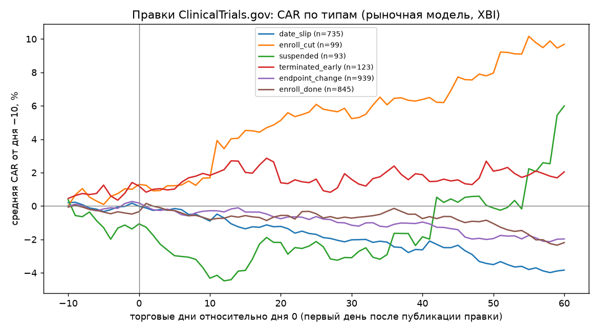

# ClinicalTrials.gov edits vs. biotech stocks

Companies must keep their ClinicalTrials.gov records up to date, and every
record keeps its full version history. When a sponsor quietly pushes back a
completion date, cuts enrollment or suspends a trial, the edit appears on the
registry, usually without a press release. **Do such "bad" edits predict a drop
in a small biotech's stock?**

The project follows a pre-registered, stage-gated spec ([SPEC.md](SPEC.md)):
each stage has a continuation criterion, and the project stops at the first
failure.

## Result

**Negative.** No edit type produces a robust abnormal return.

| Stage | What it checks | Criterion | Outcome |
|---|---|---|---|
| 0 · Sources | version history with posting dates exists for 2018 — now | yes/no | **pass** — via the site's Record History API |
| 1 · History | download and parse all versions | — | 5,841 trials, 73,091 versions |
| 2 · Sponsors | companies with a ticker, match precision | ≥ 150, ≥ 95% | **pass** — 717 companies (265 since delisted), 100% precision (n = 200) |
| 3 · Events | negative edits without a press release nearby | ≥ 300 | **pass** — 9,582 events, 7,047 negative and "quiet" |
| 4 · Event study | CAR [0,+20] significant for a negative type, stronger for the lead asset | \|t\| ≥ 2 | **fail** |

CAR [0, +20] by event type (market model vs. XBI, small caps under $10B,
price ≥ $2, liquidity filter; full tables in
[reports/stage4_event_study.md](reports/stage4_event_study.md)):

| Event type | Expected sign | N | Mean CAR | t |
|---|---|---|---|---|
| Completion date slip | − | 735 | −1.39% | −1.65 |
| Enrollment cut | − | 99 | +4.13% | +1.33 |
| Suspended / withdrawn | − | 93 | −0.81% | −0.41 |
| Terminated early | − | 123 | −0.02% | −0.01 |
| Primary endpoint changed | − | 939 | −1.03% | −1.45 |
| Sites cut | − | 147 | +0.81% | +0.47 |
| Enrollment closed short | − | 451 | +1.03% | +0.97 |
| Enrollment finished early | + | 845 | −0.08% | −0.10 |
| Completion date pulled in | + | 642 | +1.21% | +1.31 |

The closest thing to a signal was a date slip on a company's **lead asset**
(n = 133): −4.87%, t = −2.21. It did not survive the robustness checks set in
advance: without the market-model intercept it is +0.13%, and relative to XBI or
IBB it disappears. Small biotechs often run up during the estimation window,
which inflates the intercept and creates a fake "expected" return.



## What made this hard

- **No public history API.** API v2 returns only the current version. The
  version history lives behind the site's internal `/api/int/` endpoints, which
  `robots.txt` allows (Crawl-delay 1) but which return 403 to non-browser
  clients. The collector therefore runs `fetch` from a real Chromium page via
  Playwright at ≤ 1 request/s, with a watchdog that restarts it after crashes
  or stalls.
- **Submitted ≠ posted.** Each version has a submission date and a later
  posting date (median lag 2 days, p99 28). Only the posting date was visible
  to the market, so events are dated by it.
- **Survivorship bias.** 265 of the 717 sponsors have since been delisted.
  Their tickers were recovered from the cover pages of old 10-Ks, and prices
  come from Alpaca, which keeps delisted symbols. Prices are cut to each
  company's listing period, because a freed ticker can later belong to someone
  else.
- **Noise in "endpoint changes".** A manual review of 50 cases showed that 44
  were rewordings made after the trial had already finished. Only edits to
  ongoing trials count.
- **"Stale" updates.** A slip that merely replaces an already-passed planned
  date is flagged and analysed separately.

## Pipeline

```
collect/   API v2 trial list; version history via Playwright; watchdog
parse/     versions → trial_versions (status, dates, enrollment, sites, endpoint)
match/     EDGAR universe incl. delisted filers; sponsor → CIK → ticker, float, listing period
detect/    version diffs → typed, signed events; 8-K / news filter around each edit
study/     Alpaca prices (incl. delisted), XBI/IBB; market-model event study, BMP,
           date-clustered t, winsorised and no-intercept robustness checks
```

[sources.md](sources.md) documents the data-source reconnaissance. Every stage
writes its own report to [reports/](reports/).

## Running

```bash
pip install -r requirements.txt
playwright install chromium
# config.yaml: set http.sec_user_agent / ctgov_user_agent to your contact email
# .env (or environment): ALPACA_API_KEY_ID, ALPACA_API_SECRET_KEY
python match/universe.py && python match/sponsors.py
python collect/list_trials.py && python collect/supervise.py
python parse/trial_versions.py
python detect/events.py && python detect/press_filter.py
python study/prices.py && python study/event_study.py
```

Raw data and parquet outputs are not included in the repository.

## Caveats

- 1,796 negative events could not be checked against news (Google News
  returned 503 and was not retried); unchecked events were kept.
- The free-text labelling notes were removed from the CSV files in `match/`.
